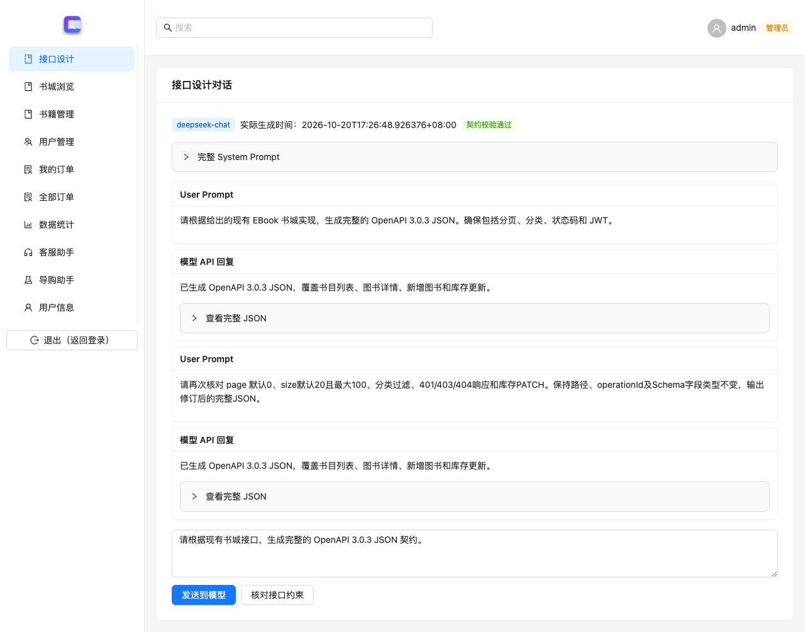
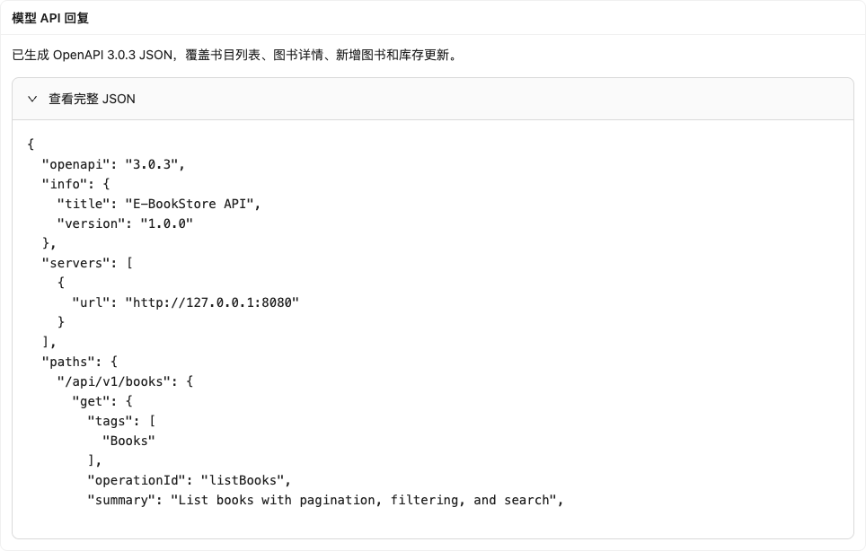

## 一、提示词

为现有 EBook 书城生成 OpenAPI 契约。System Prompt 固定项目身份、真实接口、字段和输出格式；User Prompt 分别要求生成与复核。两轮对话均通过书城的接口设计页面所连接的真实模型 API 执行。

完整 System Prompt：

```text
你是 E-BookStore 项目的后端 API 架构师，为已经存在的 Spring Boot 书城生成接口契约。
严格输出一个 OpenAPI 3.0.3 JSON 对象。禁止 Markdown 围栏、注释、解释文字、YAML、OpenAPI 3.1。
servers 必须且只能是 [{"url":"http://127.0.0.1:8080"}]，这是正在运行的原书城，禁止使用示例域名。
paths 只包含以下三个资源路径和四种操作，不创建另一个演示项目或虚构接口：
1. GET /api/v1/books：page 为从 0 开始的整数，默认 0，最小 0；size 为整数，默认 20，范围 1~100；
   category 为精确分类过滤；keyword 模糊匹配书名/作者/分类；isbn 可去除连字符后匹配。
   200 返回 {items: Book[], page: integer, size: integer, totalElements: integer, totalPages: integer}。
2. GET /api/v1/books/{id}：id 是 int64 路径参数；200 返回 Book，404 返回 Error。
3. POST /api/v1/books：仅管理员，创建成功返回 201 和 Location 响应头，响应体为 Book。
   请求必填 title/author/publisher/isbn/category/format/description（string）、price（非负 integer，元）、stockQty（非负 integer）；coverUrl 为可选 string。
4. PATCH /api/v1/books/{id}/stock：仅管理员，JSON 请求体 {stockQty: nonnegative integer}，200 返回更新后的 Book。
Book 是现有书城 DTO，字段为 id(int64)、title、author、publisher、isbn、category、format、description、coverUrl(可为空)、
price(integer)、stockQty(integer)、stockType(string)、stockText(string)。不要换成 name/count 或其它字段。
Error 至少包含 message:string；401 表示缺失/无效/过期 Bearer Token，403 表示权限不足，400 表示参数错误，404 表示资源不存在。
在 components.securitySchemes 定义 bearerAuth(type=http,scheme=bearer,bearerFormat=JWT)，全局 security 使用它。
统一用 components.schemas 与 $ref 复用 Book、BookPage、BookInput、StockInput、Error。
operationId 固定为 listBooks、getBook、createBook、updateStock。不能输出 operatorId 参数，管理员身份由 JWT 决定。
Few-Shot 约束示例：若收到 {"stockQty":37}，更新库存接口必须将它定义为 integer 且 minimum=0，不能要求重复提交整本书。
稳定性要求：后续修订必须保持这些路径、方法、operationId、字段类型、页码默认值及 $ref 名称不变。
```

第1轮完整 User Prompt：

```text
请根据给出的现有 EBook 书城实现，生成完整的 OpenAPI 3.0.3 JSON。确保包括分页、分类、状态码和 JWT。
```

第2轮完整 User Prompt：

```text
请再次核对 page 默认0、size默认20且最大100、分类过滤、401/403/404响应和库存PATCH。保持路径、operationId及Schema字段类型不变，输出修订后的完整JSON。
```

## 二、输出约束

提示词限定 OpenAPI 3.0.3 JSON，禁止 Markdown 围栏、注释、YAML 和额外解释。请求同时设置 response_format 为 json_object。生成后先做 JSON 解析，再核对真实路径、分页默认值、状态码、Schema 和 Bearer 鉴权声明；最终两轮产物均通过 OpenAPI 规范校验。

最终文件为 openapi.json。模型生成的库存请求 Schema 如下：

```json
{
  "type": "object",
  "required": [
    "stockQty"
  ],
  "properties": {
    "stockQty": {
      "type": "integer",
      "format": "int32",
      "minimum": 0
    }
  }
}
```

## 三、接口设计

接口直接对应 springboot-ebook 的 BookController，不再另建作业专用服务。

| 方法 | 资源路径 | 功能 | 成功响应 |
|---|---|---|---|
| GET | /api/v1/books | 分页与分类过滤 | 200 BookPage |
| GET | /api/v1/books/{id} | 查询单本图书 | 200 Book |
| POST | /api/v1/books | 管理员新增图书 | 201 Book，附 Location |
| PATCH | /api/v1/books/{id}/stock | 管理员更新库存 | 200 Book |

路径使用资源名词，操作由 HTTP 方法表达。新增与库存修改都使用 JSON 请求体，管理员身份来自 JWT。

## 四、参数响应

列表参数 page 从0开始，默认0；size 默认20，范围1至100；category 精确过滤分类，keyword 匹配书名、作者或分类，isbn 支持去除连字符后匹配。响应 BookPage 包含 items、page、size、totalElements 和 totalPages，items 中每条记录为现有书城的 Book DTO。

新增图书请求包含书名、作者、出版社、ISBN、分类、售卖形式、简介、整数价格和非负库存，封面地址为可选字段。库存部分更新仅要求 stockQty。错误响应至少包含 message，400 表示参数错误，401 表示未通过 Token 验证，403 表示权限不足，404 表示图书不存在。

使用 JWT 访问运行中的书城，size=2 实际返回两条书目；category=算法 只返回该分类的一条记录。这些响应保存在 runtime-evidence.json，与生成的分页和分类契约一致。

## 五、多轮对话

实际对话模型为 deepseek-chat。第一轮生成完整契约，第二轮再次核对分页、分类、错误状态码及库存更新。两轮均返回合法 JSON；资源路径、方法、operationId 及分页约束保持一致。Few-Shot 以 stockQty=37 示例约束库存请求的字段名、类型和最小值。






