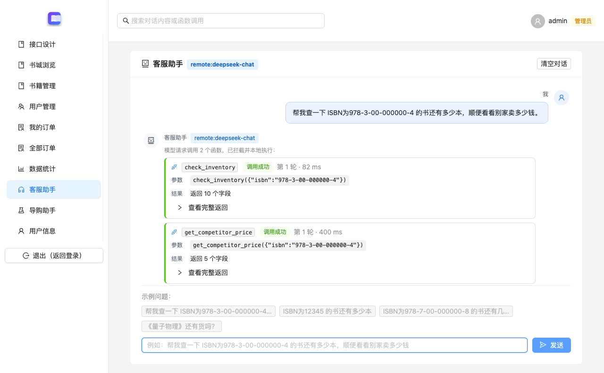
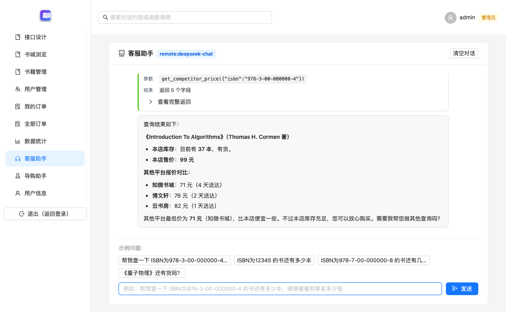
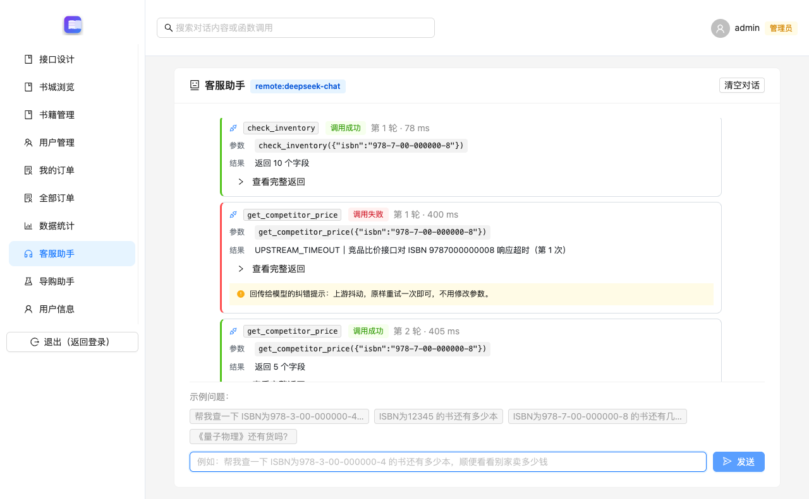

## 一、函数定义

客服助手位于原 React 书城的 /assistant 页面。Python 服务定义 check_inventory(isbn) 和 get_competitor_price(isbn)，把以下 Function Schema 放入每次模型请求的 tools 列表：

```json
[
  {
    "type": "function",
    "function": {
      "name": "check_inventory",
      "description": "查询电子书城本店的实时库存与售价。当用户询问某本书还有多少本、是否有货、能不能买到、本店卖多少钱，或需要判断库存是否足够时调用。必须先从用户的话里拿到 ISBN 再调用；如果用户只给了书名，不要猜测 ISBN，先向用户索要。",
      "parameters": {
        "type": "object",
        "properties": {
          "isbn": {
            "type": "string",
            "description": "图书的国际标准书号，10 位或 13 位，可带连字符，例如 978-3-00-000000-4 或 9783000000004。"
          }
        },
        "required": [
          "isbn"
        ],
        "additionalProperties": false
      }
    }
  },
  {
    "type": "function",
    "function": {
      "name": "get_competitor_price",
      "description": "查询其他平台（竞品）对同一本书的报价，用于和本店价格做对比。仅当用户明确要求比价、询问别家卖多少钱时才调用；如果只是问本店库存，不要调用本函数。",
      "parameters": {
        "type": "object",
        "properties": {
          "isbn": {
            "type": "string",
            "description": "图书的 ISBN，与 check_inventory 使用的是同一个值。"
          }
        },
        "required": [
          "isbn"
        ],
        "additionalProperties": false
      }
    }
  }
]
```

## 二、调用解析

模型返回 tool_calls 后，客户端读取每次调用的 id、function.name 和 function.arguments。参数使用 JSON 解析为对象，再由 ToolRegistry 根据函数名派发。JSON 无法解析、参数不是对象、缺少 ISBN 或出现未知函数时，会生成结构化错误供下一轮模型处理。

拦截点记录轮次、函数名、参数和执行结果；前端直接显示接口返回的 toolCalls，方便核对实际调用。




## 三、本地执行

check_inventory 携带当前顾客的 JWT 调用 Spring Boot 的书目接口，按 ISBN 读取现有数据库记录。书籍管理页面、订单扣库存和客服查询使用同一个 books 表。get_competitor_price 按课程要求模拟外部报价，返回平台、价格、到货时间和 source=competitor-price-mock。

联调时先通过原书城的库存 PATCH 接口把算法书库存临时改为37，再让真实模型查询。check_inventory 返回37本，模型最终回复也使用该结果；验证结束后恢复原库存30本。请求和响应保存在 inventory-live.json。

## 四、结果回填

每个本地结果转为 role=tool 的消息，tool_call_id 与模型原调用 id 对应，content 为 JSON 结果。把原 assistant/tool_calls 消息和全部 tool 消息追加到上下文后，再调用模型生成自然语言答复。前端显示回复，同时保留函数调用卡片和完整返回值。

本次库存与比价问答由 remote:deepseek-chat 执行，结束状态为 completed。




## 五、异常纠错

工具统一返回 code、message、retryable 和 hint。错误 ISBN 会得到 INVALID_ISBN_FORMAT，模型据此请用户确认；可重试的模拟接口超时返回 UPSTREAM_TIMEOUT，提示原样重试一次。

实际超时用例中，第1轮的 get_competitor_price 返回超时；模型读取该 tool 结果后，在第2轮再次调用同一函数并成功。两次调用分属不同模型轮次，说明重试是依据回填结果作出的后续决策。循环另设最大轮次与连续错误限制。



