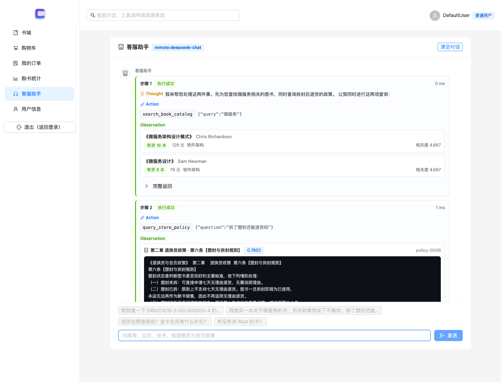
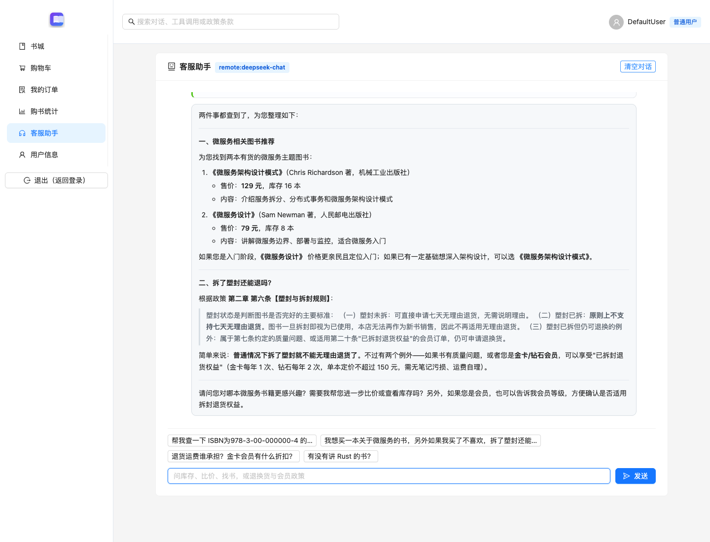

## 一、政策向量化

书城的退换货与会员政策存放在 python-assistant/data/policy.txt，包含5章25条课程模拟政策。加载时清除排版分隔线，保留版本、章节和条款信息；按条款分块，超长内容按句子拆分，窗口420字符、重叠60字符，每块保留标题和编号。

本次清洗后共3480字符，产生26个分块。使用 sentence-transformers:BAAI/bge-small-zh-v1.5 在本地生成512维稠密向量并做L2归一化。文档和查询使用同一编码器，分块及全部向量保存在 policy-vectors.json。

## 二、政策检索

RAG 参照课程 Simple RAG 示例：逐块计算 Embedding，保存为内存向量列表，对查询向量逐项计算余弦相似度，再取 Top-K。query_store_policy 默认返回前三条、过滤低于0.55的结果，结果含条款正文、章节、块编号和分数。模型据这些观测回答政策问题，并引用条款。

索引缓存指纹包含政策文本、分块参数和编码器名称。语料或参数变化后重建索引；没有达到阈值的条款时返回 POLICY_NOT_COVERED，避免将弱相关内容直接作为依据。

## 三、ReAct循环

荐书与政策功能位于与库存客服相同的 /assistant 页面，并调用 /api/assistant/chat。同一个 ReAct 循环把模型返回的 Thought 与结构化 tool_calls 记录为 Thought、Action、Action Input；工具实际执行后以 Observation 回填。模型在没有待执行工具时输出最终答复。

四个工具共用 UnifiedRegistry：库存和比价使用作业2 的实现，书目搜索与政策 RAG 使用作业3 的实现。完整步骤同源返回给前端并写入运行日志。

## 四、工具路由

search_book_catalog 通过当前顾客的 JWT 读取书城目录，按标题、分类、作者和简介检索，并支持价格和现货过滤。query_store_policy 检索同一 Agent 访问的本地政策向量库。实际复合问题中，模型在一轮返回这两个 Function Calls；UnifiedRegistry 按查书、查政策的顺序执行，再把两项 Observation 回填给模型生成最终答复。




## 五、执行链路

实际用户提问为“我想买一本关于微服务的书，另外如果我买了不喜欢，拆了塑封还能退吗？”。本次使用 remote:deepseek-chat，共2轮，结束状态为completed。以下摘录统一客服助手返回的实际 Thought 和参数，并将观测按书名或条款号摘要；完整工具调用和 Observation 见 react-case.json 和运行日志。

```text
Thought: 我来帮您处理这两件事。先为您查找微服务相关的图书，同时查询拆封后退货的政策。

让我同时进行这两项查询：
Action: search_book_catalog
Action Input: {"query": "微服务"}
Observation 摘要: {"source": "bookstore-api", "count": 2, "titles": ["微服务架构设计模式", "微服务设计"]}

Action: query_store_policy
Action Input: {"question": "拆了塑封还能退货吗"}
Observation 摘要: {"source": "policy-rag", "count": 3, "clauses": ["第六条【塑封与拆封规则】", "第八条【不支持退换的商品】", "第二十条【已拆封退货权益】"]}
```

最终答复同时推荐数据库中的微服务图书，并依据第六条说明一般拆封退货规则，补充质量问题和会员权益例外。



