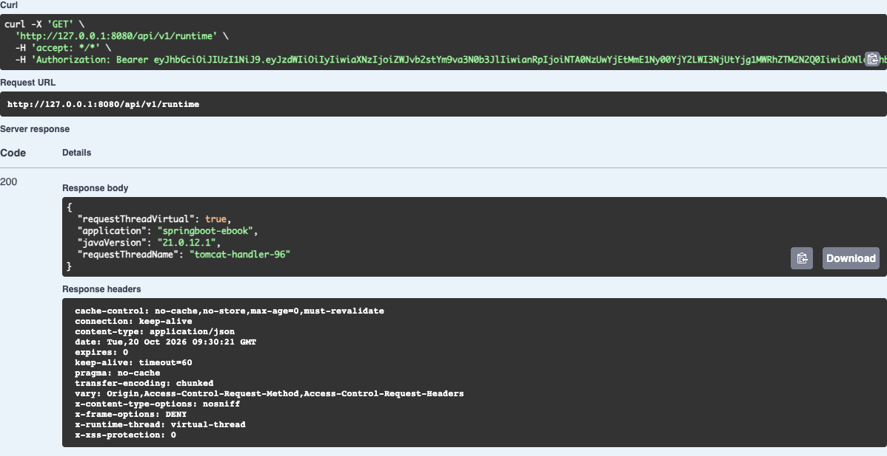
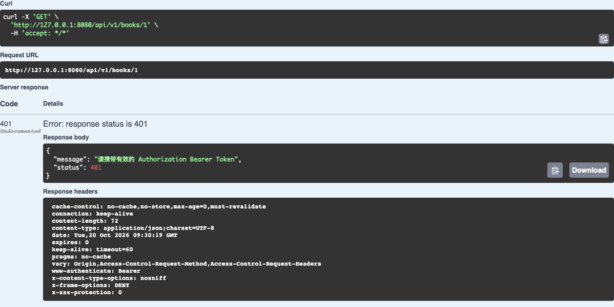
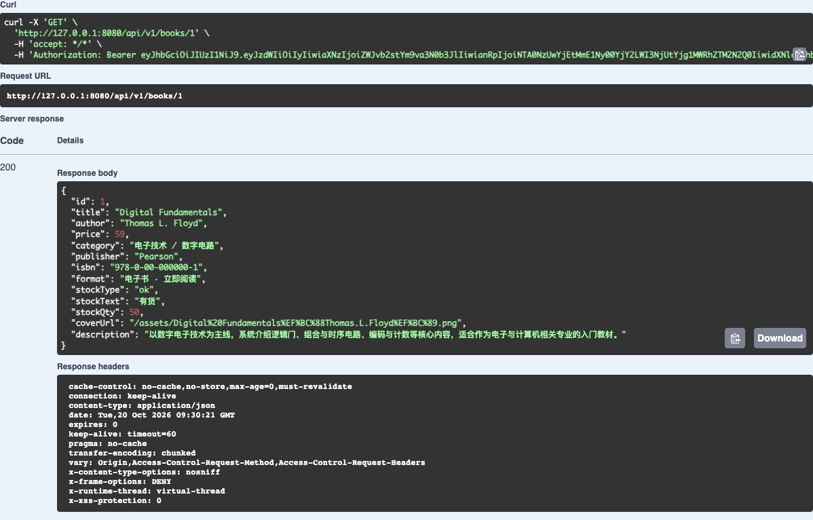

## 一、接口设计

高并发与鉴权改造直接加入原 springboot-ebook，不另建作业后端。原有 MySQL、JPA、图书管理、购物车、订单和统计功能继续使用。GET /api/v1/books 提供分页列表，GET /api/v1/books/{id} 返回图书 JSON，POST 新增返回201与Location，PATCH /books/{id}/stock 更新库存，资源不存在返回404。

## 二、虚拟线程

项目使用 Spring Boot 3.3.5，以 Java21 编译和运行。application.properties 设置 spring.threads.virtual.enabled=true；VirtualThreadConfig 把 Tomcat 协议处理器的执行器设为 Executors.newVirtualThreadPerTaskExecutor()。BookService 在查询前默认 Thread.sleep(50) 模拟慢查询。

真实网络测试同时发送200个图书查询，全部返回200，且响应头 X-Runtime-Thread 均为 virtual-thread。运行接口直接返回当前请求线程的 isVirtual()，截图中 Java 版本为21且 requestThreadVirtual=true。




## 三、JWT生成

项目集成 JJWT 0.12.6。原有 POST /api/v1/users/login 校验书城账号密码后，返回 user、accessToken、tokenType和expiresIn。JwtTokenService 使用HS256签名，sub绑定用户主键，附带username、role、iss、jti、iat与exp，有效期默认3600秒。前端保存Token，并在后续业务及AI请求中携带Authorization。

```java
return Jwts.builder()
        .subject(user.getId().toString())
        .issuer("ebook-bookstore")
        .id(UUID.randomUUID().toString())
        .issuedAt(Date.from(now))
        .expiration(Date.from(now.plusSeconds(ttlSeconds)))
        .signWith(key, Jwts.SIG.HS256)
        .compact();
```

上述为签发关键逻辑，实际代码还写入username和role。签名密钥从配置读取，强度不足时由密钥库拒绝。

## 四、无状态鉴权

SecurityConfig 使用 SessionCreationPolicy.STATELESS，关闭表单登录、HTTP Basic和请求会话缓存。JwtAuthenticationFilter 提取Bearer Token，校验签名、签发方和有效期；再读取现有用户记录，核对账号是否启用以及当前权限。请求结束后清理认证上下文，不创建Session或服务端Token表。

CurrentUser 将路径userId和查询operatorId与已认证身份绑定，普通用户无法伪造管理员编号或访问他人购物车、订单、资料。AI服务将同一顾客JWT转发给书城读取库存。登录响应没有Set-Cookie；未携带或篡改Token返回401，权限不足返回403。

## 五、鉴权测试

在同一书城的 Swagger UI 实际执行 GET /api/v1/books/1。首次未设置Authorization，服务器返回401，响应体提示需要有效的Bearer Token。截图保留实际请求地址、状态行和响应体。




使用原书城登录接口签发的Token，通过Swagger的Authorize设置Bearer凭证，再执行相同查询。服务器返回200和数据库中Digital Fundamentals的图书记录，响应头同时标明virtual-thread。



